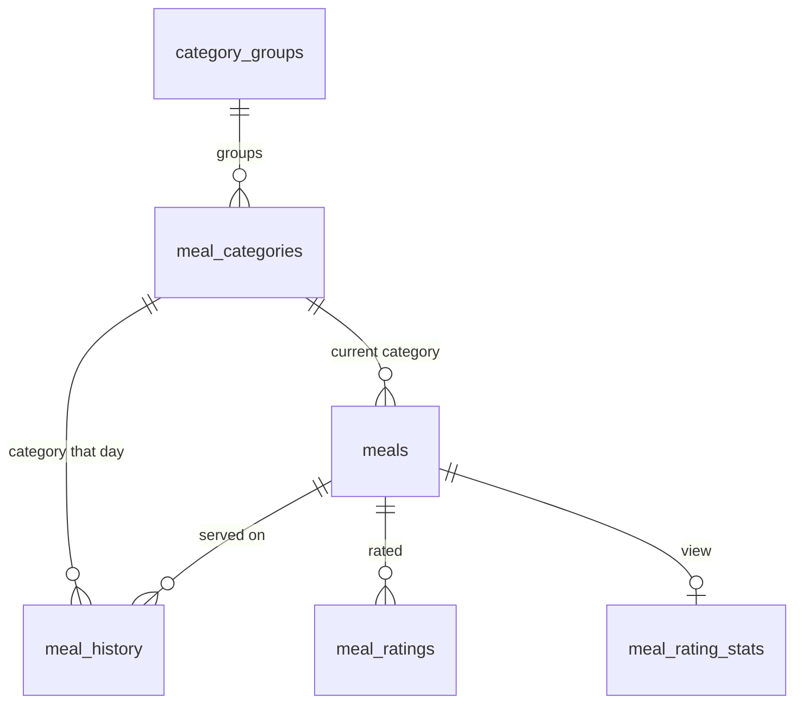

# Plan: New mensa data model

Status: **schema implemented** (`src/lib/db/schema/mensa.ts`, migrations in `src/lib/db/migrations/`) · Scope: database, scraper, admin

## 1. Decisions

| Topic          | Decision                                                                                                                                                                                                                                                                              |
| -------------- | ------------------------------------------------------------------------------------------------------------------------------------------------------------------------------------------------------------------------------------------------------------------------------------- |
| Namespace      | Postgres schema **`ulmiversitaet`** for every table of the website. Tables inside have no prefix (`ulmiversitaet.meals`, later `ulmiversitaet.events`). Legacy `public.*` tables stay untouched until cutover                                                                         |
| Meals          | **One table `meals`** with every dish that ever appeared and its _current_ data: name, English name, category, allergens, types, prices, nutrition. No slug, identified by `id`                                                                                                       |
| History        | **`meal_history`**: which meal was on the menu on which day, with that day's name, category, and prices                                                                                                                                                                               |
| Ratings        | **`meal_ratings`** (taste/look/price + optional comment) linked to the meal                                                                                                                                                                                                           |
| Categories     | **Collected automatically.** Every category printed on the menu becomes a row in `meal_categories`. In the admin, each one is assigned to a **category group** (`PIZZA I`, `PIZZA II` → _Pizza_). Groups decide name, color, icon, order, and whether they are shown on the home page |
| Price tracking | **`price_history`**: daily average prices (as today)                                                                                                                                                                                                                                  |
| Name matching  | **Keep fuzzy matching** (the mensa names the same dish slightly differently), made safer (§5)                                                                                                                                                                                         |
| Hosting        | Vercel Hobby → **one cron run per day**. No lunchtime/sold-out updates                                                                                                                                                                                                                |

## 2. Tables



| Table                        | Content                                                                                            | Who writes it                         |
| ---------------------------- | -------------------------------------------------------------------------------------------------- | ------------------------------------- |
| `category_groups`            | Display categories: name de/en, kind (main/side/dessert/other), color, icon, order, `show_on_home` | Admin                                 |
| `meal_categories`            | Raw category names as printed on the menu, each optionally assigned to a group                     | Scraper inserts, admin assigns        |
| `meals`                      | One row per dish with its most recent data                                                         | Scraper (admin can edit/merge)        |
| `meal_history`               | One row per dish per day: date, meal, category, name as printed, prices                            | Scraper                               |
| `meal_ratings`               | Ratings and comments                                                                               | Users (Server Action), admin can hide |
| `meal_rating_stats` _(view)_ | Count, averages, and Bayesian score per meal, always computed from `meal_ratings`                  | —                                     |
| `price_history`              | Daily average prices for main dishes, desserts, sides                                              | Scraper                               |

## 3. Schema (Drizzle)

Validated: typechecks, `drizzle-kit generate` produces clean SQL, and the DDL was run in a local Postgres (PGlite + pg_trgm) together with the matching, grouping, and merge queries from §4, §5, and §7.

```ts
import { isNull, sql } from "drizzle-orm";
import {
  boolean,
  check,
  date,
  index,
  integer,
  pgSchema,
  real,
  smallint,
  text,
  timestamp,
  unique,
  uuid,
} from "drizzle-orm/pg-core";

/** One Postgres schema for every table of the website */
export const ulmiversitaet = pgSchema("ulmiversitaet");

const createdAt = () =>
  timestamp("created_at", { withTimezone: true }).defaultNow().notNull();
const updatedAt = () =>
  timestamp("updated_at", { withTimezone: true })
    .defaultNow()
    .notNull()
    .$onUpdate(() => new Date());

/** Lower-case name without spaces/punctuation, computed by Postgres, used for matching */
const nameKey = (column: string) =>
  text("name_key")
    .notNull()
    .generatedAlwaysAs(
      sql.raw(`lower(regexp_replace("${column}", '[^[:alnum:]]+', '', 'g'))`),
    );

// ─── Categories ──────────────────────────────────────────────────────────────

export const categoryKind = ulmiversitaet.enum("category_kind", [
  "main", // counts as main dish (price tracking, best/worst meals, guru)
  "side",
  "dessert",
  "other",
]);

/** Display categories, created and maintained in the admin dashboard ("Pizza") */
export const categoryGroups = ulmiversitaet.table("category_groups", {
  id: integer("id").primaryKey().generatedAlwaysAsIdentity(),
  nameDe: text("name_de").notNull().unique(),
  nameEn: text("name_en"),
  kind: categoryKind("kind").notNull().default("main"),
  /** Hex color, e.g. `#22c55e` */
  color: text("color"),
  /** lucide-react icon name, e.g. `pizza` */
  icon: text("icon"),
  sortOrder: integer("sort_order").notNull().default(100),
  /** Shown in the mensa section of the home page */
  showOnHome: boolean("show_on_home").notNull().default(false),
  createdAt: createdAt(),
});

/**
 * Categories exactly as printed on the menu ("PIZZA I", "FLEISCH + FISCH").
 * Inserted automatically by the scraper; assigned to a group in the admin.
 */
export const mealCategories = ulmiversitaet.table("meal_categories", {
  id: integer("id").primaryKey().generatedAlwaysAsIdentity(),
  name: text("name").notNull().unique(),
  /** `null` = not assigned yet → shown under its own name, never on the home page */
  groupId: integer("group_id").references(() => categoryGroups.id, {
    onDelete: "set null",
  }),
  createdAt: createdAt(),
});

// ─── Meals ───────────────────────────────────────────────────────────────────

/** Every dish that ever appeared, with its most recent data */
export const meals = ulmiversitaet.table(
  "meals",
  {
    id: uuid("id").primaryKey().defaultRandom(),
    name: text("name").notNull(),
    nameKey: nameKey("name"),
    nameEn: text("name_en"),

    categoryId: integer("category_id")
      .notNull()
      .references(() => mealCategories.id),

    /** Menu codes, e.g. `{"23","27","34W"}`; names are mapped in code, unknown codes are kept */
    allergens: text("allergens")
      .array()
      .notNull()
      .default(sql`'{}'`),
    /** Diet/meat icons, e.g. `{"van"}`, `{"S"}`, `{"veg"}` */
    types: text("types")
      .array()
      .notNull()
      .default(sql`'{}'`),

    priceStudentCents: integer("price_student_cents"),
    priceEmployeeCents: integer("price_employee_cents"),
    priceGuestCents: integer("price_guest_cents"),
    /** e.g. "je 100g" */
    priceNote: text("price_note"),

    // Nutrition per portion
    energyKcal: integer("energy_kcal"),
    energyKj: integer("energy_kj"),
    proteinG: real("protein_g"),
    fatG: real("fat_g"),
    saturatedFatG: real("saturated_fat_g"),
    carbohydratesG: real("carbohydrates_g"),
    sugarG: real("sugar_g"),
    saltG: real("salt_g"),
    co2G: integer("co2_g"),

    /** Date of the menu the current values come from; older scrapes never overwrite newer data */
    lastServedOn: date("last_served_on", { mode: "string" }).notNull(),

    createdAt: createdAt(),
    updatedAt: updatedAt(),
  },
  (t) => [
    index("meals_name_key_idx").on(t.nameKey),
    index("meals_name_trgm_idx").using("gin", sql`${t.name} gin_trgm_ops`),
    index("meals_category_idx").on(t.categoryId),
  ],
);

/** Which meal was on the menu on which day, with that day's name, category, and prices */
export const mealHistory = ulmiversitaet.table(
  "meal_history",
  {
    id: integer("id").primaryKey().generatedAlwaysAsIdentity(),
    date: date("date", { mode: "string" }).notNull(),
    mealId: uuid("meal_id")
      .notNull()
      .references(() => meals.id, { onDelete: "cascade" }),
    categoryId: integer("category_id")
      .notNull()
      .references(() => mealCategories.id),

    /** Name as printed that day (the meal's name may change later) */
    name: text("name").notNull(),
    nameKey: nameKey("name"),

    priceStudentCents: integer("price_student_cents"),
    priceEmployeeCents: integer("price_employee_cents"),
    priceGuestCents: integer("price_guest_cents"),
    priceNote: text("price_note"),

    /** Order on the menu that day */
    position: smallint("position").notNull().default(0),
    createdAt: createdAt(),
  },
  (t) => [
    unique("meal_history_date_meal_key").on(t.date, t.mealId),
    index("meal_history_meal_date_idx").on(t.mealId, t.date.desc()),
    index("meal_history_name_key_idx").on(t.nameKey),
  ],
);

// ─── Ratings & comments ──────────────────────────────────────────────────────

export const mealRatings = ulmiversitaet.table(
  "meal_ratings",
  {
    id: integer("id").primaryKey().generatedAlwaysAsIdentity(),
    mealId: uuid("meal_id")
      .notNull()
      .references(() => meals.id, { onDelete: "cascade" }),

    taste: smallint("taste").notNull(),
    look: smallint("look").notNull(),
    price: smallint("price").notNull(),
    /** Weighted total, computed by Postgres */
    total: real("total")
      .notNull()
      .generatedAlwaysAs(sql`(3 * taste + 2 * look + price)::real / 6`),

    comment: text("comment"),
    /** Set in the admin to hide spam; hidden ratings are excluded from all stats */
    hiddenAt: timestamp("hidden_at", { withTimezone: true }),
    createdAt: createdAt(),
  },
  (t) => [
    index("meal_ratings_meal_idx").on(t.mealId, t.createdAt.desc()),
    check(
      "meal_ratings_values_check",
      sql`taste between 1 and 5 and look between 1 and 5 and price between 1 and 5`,
    ),
    check("meal_ratings_comment_check", sql`char_length(comment) <= 1000`),
  ],
);

/** Rating aggregates per meal; `score` is a Bayesian average (prior 3.0, weight 2) for rankings */
export const mealRatingStats = ulmiversitaet
  .view("meal_rating_stats")
  .as((qb) =>
    qb
      .select({
        mealId: mealRatings.mealId,
        count: sql<number>`count(*)::int`.as("count"),
        taste: sql<number>`avg(${mealRatings.taste})::real`.as("taste"),
        look: sql<number>`avg(${mealRatings.look})::real`.as("look"),
        price: sql<number>`avg(${mealRatings.price})::real`.as("price"),
        total: sql<number>`avg(${mealRatings.total})::real`.as("total"),
        score:
          sql<number>`((count(*) * avg(${mealRatings.total}) + 2 * 3.0) / (count(*) + 2))::real`.as(
            "score",
          ),
      })
      .from(mealRatings)
      .where(isNull(mealRatings.hiddenAt))
      .groupBy(mealRatings.mealId),
  );

// ─── Price tracking ──────────────────────────────────────────────────────────

/** Average prices per day, written by the scraper (feeds the statistics chart) */
export const priceHistory = ulmiversitaet.table("price_history", {
  date: date("date", { mode: "string" }).primaryKey(),
  avgMainStudentCents: real("avg_main_student_cents"),
  avgMainEmployeeCents: real("avg_main_employee_cents"),
  avgMainGuestCents: real("avg_main_guest_cents"),
  avgDessertStudentCents: real("avg_dessert_student_cents"),
  avgSideStudentCents: real("avg_side_student_cents"),
});
```

### Notes on the columns

- **`name_key`** is generated by Postgres: lower-case, without spaces and punctuation (`"Aprikosen Joghurt"` and `"Aprikosen-Joghurt"` → `aprikosenjoghurt`). It makes the first matching step exact and indexed. It exists on `meals` _and_ `meal_history`, so every name a dish was ever printed under still matches it.
- **`allergens` / `types` store the codes printed on the menu** (`"24"`, `"34W"`, `"van"`, `"S"`). The code → name/icon mapping lives in `src/features/mensa/codes.ts`. Unknown codes (e.g. `34G` = Gerste, which today's scraper silently drops) are stored anyway and shown as the raw code until the mapping is extended. These codes come from the EU allergen labeling and change very rarely, unlike categories.
- **Prices in cents** (`465` instead of `"4.65"`), nutrition as numbers. CO₂ per portion and kJ are new (the page has them, we don't store them yet).
- **`last_served_on`** guards the "current" values: the scraper also loads next week, so a meal's current price/name/category is only overwritten by data from a date ≥ `last_served_on`. It is also the "zuletzt serviert am" date on the meal page.
- **`meal_history.name`** keeps the name as printed that day, because `meals.name` changes whenever the mensa renames the dish.
- **Rating averages are not stored on the meal.** Today 3 meals already have averages that don't match their ratings (read-modify-write race). The view computes them from the ratings, and `total` (3·taste + 2·look + price)/6 is a generated column.
- **Dates** are `date` columns as `YYYY-MM-DD` strings; timestamps are `with time zone`. This removes the `setHours(8)` workarounds.

## 4. Categories

```
menu headline          meal_categories          category_groups (admin)
"PIZZA I"        ──►   PIZZA I   ─┐
"PIZZA II"       ──►   PIZZA II  ─┴──────►      Pizza       (main, home: no)
"VEGAN"          ──►   VEGAN     ─────────►     Vegan       (main, home: yes)
"KAFFEEBAR" (new)──►   KAFFEEBAR  (unassigned → admin overview)
```

- **Scraper:** `insert into meal_categories (name) values (…) on conflict (name) do nothing`. The name is normalized (trimmed, upper-case, single spaces). If a group with the same name exists (`VEGAN` → _Vegan_), it is assigned automatically; otherwise the category stays unassigned and appears in the admin overview.
- **Unassigned categories** are shown on the mensa page under their raw name (title-cased), never on the home page, and don't count for price tracking until assigned.
- **Admin:** assign/reassign a category to a group via a dropdown. This applies to all history at once, because history references the raw category. Create, rename, and sort groups, set color/icon/kind, and toggle **"show on home page"**.
- **`kind`** replaces the hard-coded `mainDishCategories` / `sideDishCategories` arrays used by price tracking, best/worst meals, and the guru.

Menu query for a day (validated):

```sql
select coalesce(g.name_de, c.name) as category, g.show_on_home, h.*, m.*
from meal_history h
join meals m on m.id = h.meal_id
join meal_categories c on c.id = h.category_id
left join category_groups g on g.id = c.group_id
where h.date = $1
order by g.sort_order nulls last, h.position;
```

## 5. Meal matching

For each dish on the menu:

1. **Exact:** `name_key` equals a meal's current `name_key` **or** any `meal_history.name_key` of that meal → same meal. This catches spacing/hyphen variants and every name the dish has been printed under before (including after admin merges).
2. **Fuzzy (as today):** `similarity(name, $name) >= 0.75` (pg_trgm, GIN index), **only if the diet/meat `types` are identical**. Without this guard, today's matching would merge _"Pizza Flammkuchen-Art mit Schmand, **Speck**…"_ into _"…mit **veganem** Schmand…"_ (similarity 0.79). With it, the vegan dish becomes its own meal.
3. **No match → new meal.**

On a match, the meal's current values (name, English name, category, allergens, types, prices, nutrition) are updated if the menu date ≥ `last_served_on`.

Fixes for current bugs:

- **"Ausverkauft"** as a name is skipped. The dish is identified via the English name (which still shows the real dish) or skipped for that day, so no junk meal is created. No sold-out tracking otherwise.
- **English names** are matched to German ones **by position** (both documents list dishes in the same order) instead of by price/kcal. Falls back to the old heuristic only if the category sequence differs.
- **Stale entries:** when a day is re-scraped, history rows for that day that are no longer on the menu are deleted. Today they stay forever.

Known limit (same as today): bigger name changes like _"Tikka Masala mit veganem Hähnchen"_ → _"… und Fladenbrot"_ stay below 0.75 and create a new meal. These are fixed with **merge** in the admin (§7), after which both names match the merged meal via step 1.

## 6. Scraper & cron (Vercel Hobby) — implemented

Code: `src/features/mensa/scraper/` (fetch → parse → merge DE/EN) and `src/features/mensa/sync/` (write to DB).

| Job                         | Schedule (UTC, `vercel.json`)                                                | What it does                                                           |
| --------------------------- | ---------------------------------------------------------------------------- | ---------------------------------------------------------------------- |
| `/api/cron/mensa/next-week` | `0 4 * * 5` — Fridays, 05:00–05:59 Berlin (winter)                           | Loads Monday–Friday of next week, so the menu can be shown in advance  |
| `/api/cron/mensa/today`     | `0 7 * * 1-5` — weekdays, 08:00–08:59 (winter) / 09:00–09:59 (summer) Berlin | Refreshes today's menu (the mensa sometimes changes it in the morning) |

- Hobby runs each job once a day, somewhere within the given hour. Both are protected by `CRON_SECRET`.
- Manual runs: `?week=YYYY-MM-DD` (next-week job) and `?date=YYYY-MM-DD` (today job).
- The menu is published several weeks ahead; the endpoint requires the `startThisWeek`/`startNextWeek` parameters.
- Everything is an upsert, so re-running a job is harmless. A week takes ~3 s.
- Bug in the old setup: the "daily" job was scheduled `0 6 * * 1` (Mondays only).

## 7. Admin dashboard — implemented (see README "Admin dashboard")

**Login:** one account from `.env` (`ADMIN_USERNAME`, `ADMIN_PASSWORD`). A Server Action compares the credentials with `crypto.timingSafeEqual` and sets an `httpOnly`, `secure` cookie with a JWT signed by `SESSION_SECRET` (jose, 7 days). No sessions table, so `ulmiversitaet_sessions` is not migrated. `proxy.ts` redirects `/admin/*` to the login page when the cookie is missing; every admin page and Server Action additionally calls `requireAdmin()`.

| Page           | Actions (all Server Actions, validated with zod)                                                              |
| -------------- | ------------------------------------------------------------------------------------------------------------- |
| **Overview**   | Last scrape, unassigned categories, unknown allergen codes, newest meals                                      |
| **Categories** | List of raw categories with group dropdown; create/rename/sort groups, color, icon, kind, "show on home page" |
| **Meals**      | Search, edit name/English name, **merge** meal B into A, with similar-name suggestions (trigram)              |
| **Comments**   | Latest ratings with comments, hide/unhide                                                                     |
| **Events**     | Existing feature, ported                                                                                      |

**Merge** (validated) runs as one `db.batch`: delete B's history rows on days where A also has one → move B's history and ratings to A → delete B. Afterwards every name B was printed under matches A via `meal_history.name_key`.

## 8. App side (Next.js 16)

- **Reads:** functions in `src/features/mensa/data/` with `"use cache"` + `cacheTag("mensa:menu" | "mensa:meals" | "mensa:stats" | "mensa:categories")` + `cacheLife`. The home page and the mensa pages read the database directly; no more HTTP call from ulmiversitaet.de to the mensa API.
- **Rating form:** Server Action with `useActionState` + zod. Inserts the rating and calls `updateTag("mensa:meals")` so the user sees it immediately.
- **Admin mutations:** Server Actions + `updateTag(...)` for the affected tags.
- **Cron:** Route Handler (Server Actions are for UI mutations), protected by `CRON_SECRET`.
- **Meal URLs:** `/mensa/meal/<id>`.

## 9. Migration of the existing data (deferred)

> Not part of the current work. The new app starts with an empty mensa database; importing the legacy data can be tried later. The mapping below is kept for reference.

Run first against a **Neon branch** (instant copy of production), then on main. A re-runnable script `scripts/mensa/migrate-legacy.ts` empties the new tables and imports everything again, so it can be run during development and once more at cutover.

| Legacy (`public.*`)               | → `ulmiversitaet.*`                  | Mapping                                                                                                                                                                                                                                                                                                                                                                                                  |
| --------------------------------- | ------------------------------------ | -------------------------------------------------------------------------------------------------------------------------------------------------------------------------------------------------------------------------------------------------------------------------------------------------------------------------------------------------------------------------------------------------------- |
| category enum + `mealCategoryMap` | `category_groups`, `meal_categories` | One group per old category (Sattmacher, Topf & Pfanne, Prima Klima, Fleisch & Fisch, Vegan, Vegetarisch, Specials, Pizza, Pasta, Snacks, Dessert, Salat, Salatbuffet, Beilage) with today's colors and icons and the right kind. Raw categories: the old enum values plus the known printed variants (`TOPF + PFANNE`, `FLEISCH + FISCH`, `PIZZA I/II/III`, …), all pre-assigned. `UNKNOWN` → unassigned |
| `mensa_meals` (458)               | `meals`                              | Keep `id`. `allergy`/`types` enum values → printed codes (reverse of the old maps). Price and nutrition text → numbers. `last_served_on` = last plan date. Rating columns dropped (view). Slug dropped                                                                                                                                                                                                   |
| `mensa_mensa_plan` (3,133)        | `meal_history`                       | Date, meal, the meal's category. Name and prices = the meal's last known values (**approximation**: the real per-day prices were never stored)                                                                                                                                                                                                                                                           |
| `mensa_ratings` (705)             | `meal_ratings`                       | 1:1. Values are already whole numbers 1–5; `text` → `comment`; `total` is generated                                                                                                                                                                                                                                                                                                                      |
| `mensa_price_tracking` (217)      | `price_history`                      | 1:1 (exact)                                                                                                                                                                                                                                                                                                                                                                                              |
| meal `ausverkauft`                | —                                    | Dropped with its 2 plan entries (no ratings)                                                                                                                                                                                                                                                                                                                                                             |
| 2 meals with identical names      | —                                    | Merged into the one with ratings                                                                                                                                                                                                                                                                                                                                                                         |

Checks at the end: row counts, ratings per meal, average per meal equal to legacy (except the 3 meals whose stored averages had drifted), and every `meal_history` row has a category.

**Cutover:** turn off the old mensa cron → run the migration a last time → enable the new cron → redirect `mensa.ulmiversitaet.de` to `/mensa`. After about a month: `pg_dump` the legacy tables, then drop them.

## 10. Resolved questions

- **Old meal links:** not redirected.
- **Locations:** only the Mensa of Ulm University (`locationId=1`); the cafeterias are out of scope.
- **Spam protection:** later. For now, as in the old app, the browser remembers in a cookie that it already rated today.
- **Legacy data:** migration deferred (§9).
